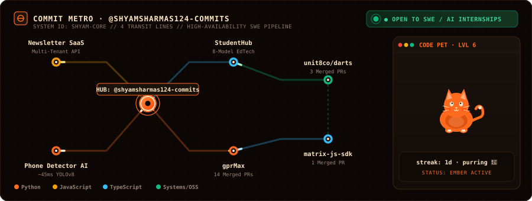

 

---

### 👨‍💻 Engineering Profile

Backend & Systems Engineer specializing in scalable REST/GraphQL APIs, real-time computer vision inference, and open-source systems engineering. Passionate about transactional data safety, low-latency execution, and maintainable software architecture.

- 🔭 **Current Focus:** Distributed API architectures, multi-tenant databases, and low-latency computer vision (~45ms YOLOv8).
- 🛠️ **Open Source:** 18 merged pull requests across industry simulation tools and ML time-series libraries ([`gprMax/gprMax`](https://github.com/gprMax/gprMax), [`unit8co/darts`](https://github.com/unit8co/darts), [`matrix-org/matrix-js-sdk`](https://github.com/matrix-org/matrix-js-sdk)).
- 🎓 **Education:** CS & Software Engineering student at **Kalvium** (1st Year).
- ⚡ **Engineering Principles:** Zero unhandled errors, transactional writes, atomic exports, and deterministic schemas.

---

### 🚀 Featured Engineering Projects

<table>
  <tr>
    <td width="50%" valign="top">
      <h4><a href="https://github.com/shyamsharmas124-commits/newsletter-saas">⚡ Newsletter SaaS – Multi-Tenant API</a></h4>
      
High-throughput multi-tenant newsletter backend featuring JWT refresh-token rotation, role-based access control (RBAC), and HMAC-signed mock payment verification workflows.

      <ul>
        <li><b>Architecture:</b> Express, MongoDB aggregation pipelines, Redis cache layer.</li>
        <li><b>Security:</b> Cryptographic webhook verification, rate-limiting & sanitized payloads.</li>
      </ul>
      
<code>Node.js</code> <code>Express</code> <code>MongoDB</code> <code>JWT</code> <code>REST API</code>

    </td>
    <td width="50%" valign="top">
      <h4><a href="https://github.com/shyamsharmas124-commits/phonedetector">🎯 Phone Detector AI – ~45ms YOLOv8</a></h4>
      
Real-time edge computer vision inference pipeline detecting mobile phone presence via video streams at ~45ms latency with automated browser audio/visual alerts.

      <ul>
        <li><b>Model:</b> Optimized YOLOv8 PyTorch checkpoint with OpenCV tensor preprocessing.</li>
        <li><b>Interface:</b> Flask streaming server with WebSocket broadcast state machine.</li>
      </ul>
      
<code>Python</code> <code>Flask</code> <code>YOLOv8</code> <code>OpenCV</code> <code>PyTorch</code>

    </td>
  </tr>
  <tr>
    <td width="50%" valign="top">
      <h4><a href="https://github.com/shyamsharmas124-commits/studenthub">📚 StudentHub – 8-Model EdTech</a></h4>
      
Collaborative peer-to-peer educational knowledge base with relational schema modeling, resource curation engines, and multi-user progress analytics.

      <ul>
        <li><b>Database:</b> 8-model Prisma relational schema with MongoDB connector.</li>
        <li><b>Frontend:</b> Responsive React SPA with optimistic UI updates.</li>
      </ul>
      
<code>React</code> <code>Node.js</code> <code>Prisma</code> <code>MongoDB</code> <code>TailwindCSS</code>

    </td>
    <td width="50%" valign="top">
      <h4><a href="https://github.com/shyamsharmas124-commits">⚙️ Technical Stack & Leadership</a></h4>
      
Core engineering proficiencies across backend infrastructure, systems programming, and production library maintenance.

      <ul>
        <li><b>Languages:</b> Python, JavaScript (ES2024), TypeScript, C++, HTML/CSS.</li>
        <li><b>Data & Tools:</b> MongoDB, Prisma, Express, Flask, Git, Docker, Linux.</li>
      </ul>
      
<code>Distributed Systems</code> <code>API Design</code> <code>Open Source</code> <code>CI/CD</code>

    </td>
  </tr>
</table>

---

### 🌐 Open-Source Contributions (18 Merged PRs)

Contributions to production open-source ecosystems including electromagnetic simulation engines, time-series forecasting frameworks, and decentralized communication protocols:

<!-- OSS_START -->
| Repository | Pull Request | Scope / Impact | Status |
|:---|:---|:---|:---:|
| [`gprMax/gprMax`](https://github.com/gprMax/gprMax) | [#978](https://github.com/gprMax/gprMax/pull/978) | Validate output path safety and transactional writing in SFCW, FMCW, and ImpulseResponse | `MERGED` |
| [`unit8co/darts`](https://github.com/unit8co/darts) | [#3378](https://github.com/unit8co/darts/pull/3378) | Fix qr (quantile risk) zero denominator handling with zero_division | `MERGED` |
| [`gprMax/gprMax`](https://github.com/gprMax/gprMax) | [#963](https://github.com/gprMax/gprMax/pull/963) | Validate output path safety, transactional writing and origin checks in geometry export | `MERGED` |
| [`gprMax/gprMax`](https://github.com/gprMax/gprMax) | [#958](https://github.com/gprMax/gprMax/pull/958) | Validate output path safety, atomic writing and critical-angle guards in AntennaPatterns | `MERGED` |
| [`gprMax/gprMax`](https://github.com/gprMax/gprMax) | [#946](https://github.com/gprMax/gprMax/pull/946) | Validate output path safety in head extraction and reject non-finite timewindows | `MERGED` |
| [`gprMax/gprMax`](https://github.com/gprMax/gprMax) | [#945](https://github.com/gprMax/gprMax/pull/945) | Validate receiver presence and recording status in plot_Ascan, Marimo and trace tools | `MERGED` |
| [`gprMax/gprMax`](https://github.com/gprMax/gprMax) | [#940](https://github.com/gprMax/gprMax/pull/940) | Handle missing nrx attribute and validate grid paths in outputfiles_merge and plot_Bscan | `MERGED` |
| [`unit8co/darts`](https://github.com/unit8co/darts) | [#3285](https://github.com/unit8co/darts/pull/3285) | fix: preserve mode in extract_subseries and handle all-NaN series in strip | `MERGED` |
| [`gprMax/gprMax`](https://github.com/gprMax/gprMax) | [#931](https://github.com/gprMax/gprMax/pull/931) | Handle missing Name and nrx attributes in plotting toolboxes | `MERGED` |
| [`gprMax/gprMax`](https://github.com/gprMax/gprMax) | [#922](https://github.com/gprMax/gprMax/pull/922) | Normalize receiver paths and validate grids in matching_receiver_path | `MERGED` |
| [`gprMax/gprMax`](https://github.com/gprMax/gprMax) | [#908](https://github.com/gprMax/gprMax/pull/908) | Support gauspulse built-in waveform in ImpulseResponse toolbox | `MERGED` |
| [`unit8co/darts`](https://github.com/unit8co/darts) | [#3254](https://github.com/unit8co/darts/pull/3254) | fix: preserve series dtype in reconciliation transformers (#785) | `MERGED` |
| [`gprMax/gprMax`](https://github.com/gprMax/gprMax) | [#888](https://github.com/gprMax/gprMax/pull/888) | Fix FFT spectrum truncation for impulse and DC-peaked waveforms in plotting toolboxes | `MERGED` |
| [`unit8co/darts`](https://github.com/unit8co/darts) | [#3234](https://github.com/unit8co/darts/pull/3234) | docs: clarify correlation handling in multi-step probabilistic forecasts (#2778) | `MERGED` |
| [`matrix-org/matrix-js-sdk`](https://github.com/matrix-org/matrix-js-sdk) | [#5604](https://github.com/matrix-org/matrix-js-sdk/pull/5604) | Stop CapabilityPoller when fetch is in flight and stop RetentionPolicyService on stopClient | `MERGED` |
| [`gprMax/gprMax`](https://github.com/gprMax/gprMax) | [#876](https://github.com/gprMax/gprMax/pull/876) | fix: resolve gathered bscan plotting filename collision     | `MERGED` |
| [`gprMax/gprMax`](https://github.com/gprMax/gprMax) | [#869](https://github.com/gprMax/gprMax/pull/869) | fix: validate accelerator backend before allocation in htod source and receiver helpers | `MERGED` |
| [`gprMax/gprMax`](https://github.com/gprMax/gprMax) | [#858](https://github.com/gprMax/gprMax/pull/858) | fix(pml): validate local PML thickness against MPI subgrid boundaries | `MERGED` |
| [`gprMax/gprMax`](https://github.com/gprMax/gprMax) | [#861](https://github.com/gprMax/gprMax/pull/861) | feat(typing): resolve circular imports using TYPE_CHECKING and annotations | `MERGED` |
| [`gprMax/gprMax`](https://github.com/gprMax/gprMax) | [#857](https://github.com/gprMax/gprMax/pull/857) | fix(pml): validate slab thickness before MPI grid assignment | `MERGED` |
<!-- OSS_END -->

---

### 📊 Engineering Telemetry & Activity Matrix

  

---

### 🐍 Contribution Snake

  <picture>
    <source media="(prefers-color-scheme: dark)" srcset="https://raw.githubusercontent.com/shyamsharmas124-commits/shyamsharmas124-commits/output/github-snake-dark.svg" />
    <source media="(prefers-color-scheme: light)" srcset="https://raw.githubusercontent.com/shyamsharmas124-commits/shyamsharmas124-commits/output/github-snake.svg" />
    
  </picture>

---

### 🌐 Connect With Me

  
  
  
  

---

Crafted with obsidian-ember telemetry &bull; **[@shyamsharmas124-commits](https://github.com/shyamsharmas124-commits)** &bull; Open for SWE / AI Internships

